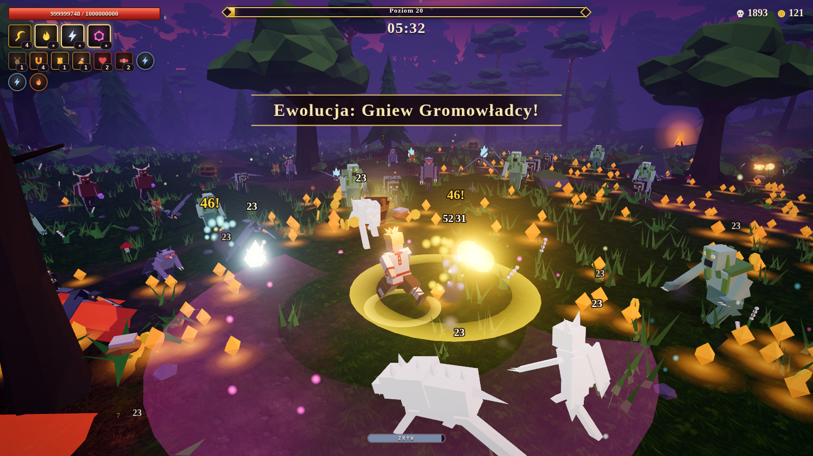
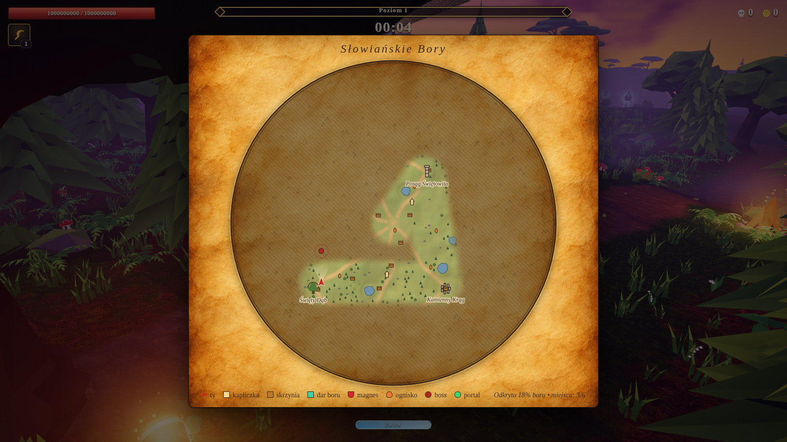

# MegaBerg: Słowiańskie Bory

Oryginalna gra 3D z gatunku „survivors-like” (roguelite z automatycznym atakiem) osadzona w słowiańskim
folklorze. Zapada zmierzch, z kniei wyłażą chochliki, utopce i strzygi, a ty masz przetrwać 10 minut
i pokonać Leszego. Bronie atakują same: ty biegasz, skaczesz, robisz zrywy i wybierasz ulepszenia.

Postacie, efekty i dźwięk powstają w kodzie. Drzewa, głazy i budowle to modele zbudowane skryptem
w **Blenderze** (z wypalonym cieniowaniem otoczenia), a tekstury ziemi, pergamin mapy i ilustracja
ekranu wczytywania pochodzą z generatora obrazów **Codeksa**. Dźwięk nadal nie używa żadnych plików.
Stack: **Three.js + TypeScript (strict) + Vite**, testy w **Vitest**.





## Uruchomienie

```bash
make run
```

To wszystko: `make run` doinstaluje zależności (przy pierwszym uruchomieniu i po zmianie
`package.json`), wystartuje serwer deweloperski i otworzy grę w przeglądarce pod adresem
`http://localhost:5173`. Zatrzymanie: `Ctrl+C`. Wersja produkcyjna:

```bash
make preview
```

Bez `make` to samo robią `npm install`, `npm run dev` oraz `npm run build && npm run preview`.

Pozostałe komendy:

| Komenda | Co robi |
|---|---|
| `make help` | lista skrótów z Makefile (`run`, `build`, `preview`, `test`) |
| `npm test` | testy logiki (Vitest) |
| `npm run typecheck` | sprawdzenie typów bez budowania |
| `npm run sim -- runs=10 skill=good shop=2` | rozgrywa całe runy botem bez przeglądarki (strojenie balansu) |
| `npm run sim -- career=12 skill=novice` | „kariera”: kolejne runy na jednym zapisie z zakupami w Chacie (tempo rozwoju gracza) |
| `npm run refpack` | paczka czystych zrzutów do prac nad grafiką w `concepts/zrzuty/`: wrogowie i bohaterowie na neutralnym tle, scenerie o trzech porach, walka; `npm run refpack -- wrogowie` robi jedną grupę |
| `npm run edytor` | wewnętrzny edytor konceptów pod `http://localhost:5173/edytor`: referencje z `concepts/`, propozycje i skórki z Codeksa oraz modeli WaveSpeed (opis niżej) |

Wymagana przeglądarka z WebGL 2 (aktualny Chrome, Firefox, Edge).

## Edytor konceptów

Narzędzie wewnętrzne do prac nad grafiką, dostępne tylko w serwerze deweloperskim (`npm run edytor` albo
`/edytor` przy działającym `npm run dev`); do wersji produkcyjnej nie trafia.

1. Z biblioteki (koncepty z `concepts/` i zrzuty z `concepts/zrzuty/`, które robi `npm run refpack`) wybierasz
   do 4 referencji.
2. Wybierasz cel: **Koncept** (dowolny obraz na podstawie referencji) albo **Skórka** (nowy wygląd istniejącego
   modelu: bryła, poza i kadr zostają, zmieniają się kolory, materiały i dodatki).
3. Opisujesz, co ma powstać: wpisujesz własny opis, klikasz gotową podpowiedź (dla skórek: Zimowa, Noc Kupały,
   Dożynkowa, Dziady, Bursztynowa, Nawia) albo „✦ Zaproponuj pomysły”, a Codex obejrzy referencje i podsunie
   pięć kierunków.
4. Wybierasz modele. Jedna seria może iść naraz na kilka, więc ten sam opis da się porównać między nimi:
   - **Codex**: lokalne `codex exec` z wbudowanym generatorem obrazów, na koncie ChatGPT;
   - **WaveSpeed** (płatne, klucz w `.env`): `openai/gpt-image-2.6-flare/edit`,
     `openai/gpt-image-2.6-sunburst/edit`, `google/nano-banana-2.1/edit`, `bytedance/seedream-v5.5/edit`.
     Te modele przerabiają obraz wejściowy, więc wymagają co najmniej jednej referencji. Referencje są
     wysyłane na serwery WaveSpeed. Formularz pokazuje orientacyjny koszt serii.
5. Wyniki (1–4 na model, najwyżej 12 w serii) trafiają do `concepts/propozycje/<seria>/` razem z `meta.json`.
   Propozycję można powiększyć obok referencji, oznaczyć gwiazdką albo wziąć jako referencję do kolejnej
   iteracji.
6. Usuwanie: „×” na obrazku albo „Usuń” pod nim kasuje jedną propozycję, „Usuń serię” całą serię, a „Usuń bez
   gwiazdki” i „Usuń nieudane” (w serii albo u góry, dla wszystkich serii) sprzątają zbiorczo. Każde usunięcie
   pyta o potwierdzenie i kasuje pliki z dysku.

Konfiguracja: polecenie `codex` w `PATH` (zalogowane) dla Codeksa oraz plik `.env` w katalogu projektu z linią
`WAVESPEED=<klucz API>` dla modeli WaveSpeed. Plik `.env` jest w `.gitignore`, a klucz nie trafia do
przeglądarki. Kod: `tools/edytor/`.

## Sterowanie

| Klawisz | Akcja |
|---|---|
| `W` `A` `S` `D` | ruch (względem kamery) |
| Mysz (po kliknięciu w grę) lub `←` `→` `↑` `↓` | obrót kamery |
| `Spacja` | skok (przytrzymaj dłużej = wyżej; podwójny skok po zdobyciu Pióra Żar-ptaka) |
| `Shift` | zryw z krótką nietykalnością (odnowienie 1,5 s) |
| `E` (przytrzymaj) | otwieranie płatnych skrzyń, pokłon w kapliczce |
| `Tab` (przytrzymaj) | mapa boru; gra toczy się dalej |
| `1` `2` `3` (`4`) | wybór karty; `R` przelosowanie; `Enter` zabranie łupu ze skrzyni |
| `Esc` lub `P` | pauza (z podglądem buildu i opcjami) |
| `~` | ukryte menu dewelopera: nieśmiertelność, +1000 złota (w runie do runu, w menu do Chaty), +100 srebra, +1/+5 poziomów, edytor konceptów (tylko na `npm run dev`); w trakcie runu pauzuje grę |

## Jak się w to gra

- **Run trwa 10 minut.** Wrogowie nadchodzą falami według minutnika, coraz gęściej i coraz twardsi.
  W 2:30 i 7:30 przylatuje Baba Jaga, w 5:00 wychodzi Południca.
- **Portal Leszego:** w 10:00 25–40 m od bohatera otwiera się zielony portal (widać go też na mapie).
  Przytrzymaj przy nim `E`, a wyjdzie **Leszy**, a bór wokół ucichnie. Pokonanie Leszego to zwycięstwo;
  potem można grać dalej w trybie nieskończonym. Kto zwleka, wchodzi w **nadgodzinę** (horda gęstnieje),
  a od 12:00 w **falę końcową**: co 30 s wrogowie mają o 25% więcej zdrowia i obrażeń, aż wezwiesz Leszego.
- **Bursztyny** wypadające z wrogów to doświadczenie. Awans zatrzymuje grę i daje wybór **1 z 3 kart**:
  nowa broń, poziom broni albo **księga**. Karty mają rzadkość (zwykła, rzadka, epicka, legendarna):
  lepsza rzadkość to silniejszy bonus. Maksymalnie **4 bronie** i 5 ksiąg.
- **Księgi** podnoszą jedną statystykę na poziom (np. +10% obrażeń, +12% szybkości ataku, +4% szansy
  na krytyk, +15 tarczy) i mają **do 20 poziomów**; tylko Księga Krzemieni (pocisk) i Księga Żar-ptaka
  (skok) kończą się na 2. Na start dostępnych jest 12 ksiąg, kolejne odblokowują osiągnięcia związane ze
  stylem gry (np. Księga Sokoła na 8. poziomie odblokowuje Księgę Wilczego Kła).
- **Księga Czarnoboga** (po pokonaniu Leszego) to klątwa: więcej, silniejszych i szybszych wrogów,
  ale też więcej doświadczenia i złota.
- **Poziomy broni:** do **15. poziomu**. Poziomy 2–5 dają stałe ulepszenie danej broni (np. +1 sierp),
  a każda karta broni losuje też **linie statów** tej broni (obrażenia, szybkość ataku, obszar, czas działania,
  prędkość, odrzut, przebicie, odbicia, przeskoki pioruna). Liczba linii zależy od rzadkości: zwykła 1,
  rzadka 2, epicka i legendarna 3 (silniejsze). Nowa broń dostaje jedną linię mniej.
- **Ewolucje:** broń od 5. poziomu plus odpowiednia księga zamienia się w potężniejszą formę
  (przez skrzynię albo legendarną kartę przy awansie). Ewolucja zachowuje poziom i wylosowane linie
  i dalej rośnie do 15. poziomu.
- **Skarby:** skrzynia daje gotową ewolucję, a jeśli jej nie ma, **skarb** (przedmiot). Skarbów nie
  ogranicza liczba miejsc, kolejne kopie się sumują, a każdy ma rzadkość (szczęście daje rzadsze).
  Na start w skrzyniach jest 12 skarbów, pięć kolejnych odblokowuje Skarbiec (niżej). Jedne dodają staty (Róg tura: +8% obrażeń, Pazur rysia: krytyk), inne działają przy trafieniu albo
  zmieniają zasady: Kamień Peruna (piorun przy trafieniu), Krzemień iskrzący (wybuch), Kosa Marzanny
  (natychmiastowe zabicie zwykłego wroga), Czaszka upiora (obrażenia za zabójstwa), Mech pustelnika
  (obrażenia, gdy stoisz), Skrzydlate łapcie (szybkość ruchu w szybkość ataku), Sakiewka wędrowca
  (złoto za marsz), Dzban kowala (wyższy poziom broni), Kowadło Swaroga (więcej linii na kartach broni),
  Lustro wiedźmy (dłuższa nietykalność).
- **Skrzynie** na mapie otwiera się za złote monety. Pierwsza kosztuje 10 złota, każda kolejna jest
  wyraźnie droższa (10, 18, 31, 54, 94…). **Trzy skrzynie stoją 20–25 m od startu** i widać je na mapie
  od pierwszej sekundy. Elitarni wrogowie (świecą na złoto) i mini-bossy zostawiają darmową skrzynię
  i sakiewkę monet.
- **Dar boru:** czasami (zwykle dwa razy na run) w pobliżu bohatera pojawia się darmowa skrzynia. Nie da się jej pomylić
  z płatną: jest z białej brzozy z zielonymi okuciami i stoi w słupie zielonego światła. Otwiera się
  po dotknięciu, nie kosztuje złota i nie podnosi ceny płatnych skrzyń.
- **Magnes:** co dwie–trzy minuty w pobliżu pojawia się czerwony magnes w słupie światła.
  Podniesiony ściąga do bohatera **wszystkie bursztyny i monety z całej mapy** (jedzenie zostaje).
  Baner zapowiada magnes i dar boru, a oba widać na mapie.
- **Monety** wypadają z wrogów: na początku runu z mniej więcej co czwartego, po 3,5 minuty z co
  szesnastego. **Monety z zabitych wrogów zbierają się same**: od razu lecą do bohatera, nie trzeba
  po nie wracać. Pierwsza minuta wystarcza na pierwszą skrzynię; gra podpowie, kiedy cię na nią stać.
- **Kapliczki** (cztery rodzaje, kolor poświaty i znacznika na mapie mówi, który):
  - **bogów** (ciepłe światło): przytrzymaj `E` i wybierz błogosławieństwo Peruna (obrażenia), Swaroga (ogień),
    Welesa (szczęście i złoto) albo Mokoszy (leczenie); każdy bóg błogosławi najwyżej dwa razy na run,
  - **święty krąg** (niebieski): stój w kręgu 5 sekund (poza nim ładunek powoli spada) i wybierz 1 z 3 darów,
  - **bursztynowa** (pomarańczowa): przytrzymaj `E`, a bursztyny z całej mapy polecą do ciebie,
  - **ołtarz chciwości** (fioletowy): skarb i 30 złota za +15% klątwy do końca runu.
- **Klątwa** (ołtarz chciwości, Księga Czarnoboga): więcej, twardszych i szybszych wrogów, ale też więcej
  doświadczenia i złota.
- **Przelosowanie i wygnanie:** na karcie awansu `R` przelosowuje karty: najpierw za darmo (Kości wróżebne
  z Chaty), potem za złoto (8, 12, 18…). „Wygnaj” pod nową bronią lub księgą usuwa ją z puli do końca runu
  (12, 18, 27… złota) i dobiera inną kartę.
- **Leczenie:** z wrogów rzadko wypada chleb ze smalcem albo dzban miodu. Jedzenie czeka na ziemi,
  dopóki masz pełne zdrowie.
- **Czerwone kręgi na ziemi** to zapowiedź ataku obszarowego. Wyjdź z kręgu albo podskocz w chwili uderzenia
  (ataki naziemne da się przeskoczyć; zielone bomby Baby Jagi wybuchają także w powietrzu).
- **Bagienne kałuże** spowalniają; wyłażą z nich utopce.
- **Bór jest duży** (polana o promieniu 180 m, prawie cztery razy większa niż dawniej). Z polany startowej
  rozchodzi się sześć ścieżek do nazwanych miejsc: Posąg Świętowita, Topielcowe Jezioro, Kamienny Krąg,
  Święty Dąb, Kurhan i Chata na Kurzej Stopce. Przy każdym (poza jeziorem) czeka skrzynia, a przy ścieżkach
  stoją kapliczki i ogniska.
- **Mapa (`Tab`)** jest na początku zakryta. Odkrywa się w promieniu 30 m wokół bohatera i pokazuje teren,
  ścieżki, wodę, drzewa oraz znaczniki: kapliczki (jasne, dopóki mają błogosławieństwo), zamknięte skrzynie,
  ogniska i odkryte miejsca z nazwami. Bossa widać na mapie zawsze, także w nieodkrytej części.
- **Złoto**, które zostanie w sakiewce na koniec runu, trafia do **Chaty**: stałe ulepszenia między runami.
- **Srebro** zdobywa każdy run (minuta przetrwania = 1, każde 400 zabitych = 1, zwycięstwo = 10; więcej
  ze Srebrną skrzynką z Chaty). Wydaje się je w **Skarbcu** w Chacie: pięć skarbów (Skrzydlate łapcie,
  Lustro wiedźmy, Dzban kowala, Kowadło Swaroga, Kosa Marzanny) najpierw odblokowuje osiągnięcie związane
  ze stylem gry, a potem kupuje się je za srebro i od tej chwili wypadają ze skrzyń.
- **Rózga wróżbity** (30 srebra) pozwala wyłączać w Chacie bronie, księgi i skarby, których nie chcesz
  widzieć na kartach i w skrzyniach (zawsze zostaje co najmniej 4 bronie, 6 ksiąg i 6 skarbów).
- **Osiągnięcia** odblokowują postacie, bronie i księgi albo dają złoto.

Pierwszy run ma prawo skończyć się porażką. Po kilku ulepszeniach z Chaty Leszy jest do pokonania.

## Treść

**Bronie (10 bazowych i 10 ewolucji; 5 poziomów stałych, dalej linie statów do 15.)**

| Broń | Działanie | Księga do ewolucji | Ewolucja |
|---|---|---|---|
| Złote sierpy | krążą wokół bohatera | Księga Siłacza | Żniwa Mokoszy |
| Ogień Swarożyca | kule ognia do najbliższego wroga | Księga Krzesiwa | Krąg Swaroga |
| Grom Peruna | piorun w losowych wrogów | Księga Dębu | Gniew Gromowładcy |
| Ciupaga | szeroki zamach z odrzutem | Księga Lipowej Tarczy | Topór Peruna |
| Wianek z ziół | aura raniąca i spowalniająca | Księga Pszczół | Kwiat Paproci |
| Proca z krzemieniami | odbijające się pociski | Księga Krzemieni | Gwiezdny Grad |
| Kruki Welesa | przyzwane kruki | Księga Welesa | Stado Welesa |
| Lodowy oddech Marzanny | stożek mrozu | Księga Wędrowca | Zamieć Marzanny |
| Włócznia Świętowita | przebija szereg wrogów | Księga Tura | Cztery Oblicza |
| Garniec dziegciu | płonąca kałuża smoły | Księga Bursztynu | Smocza Smoła |

**Księgi (22, do 20 poziomów):** Siłacza (obrażenia), Krzesiwa (szybkość ataku), Dębu (obszar),
Wędrowca (ruch), Tura (zdrowie), Pszczół (regeneracja), Bursztynu (zbieranie), Welesa (szczęście),
Lipowej Tarczy (pancerz), Krzemieni (pociski, 2 poziomy), Zielarki (doświadczenie), Sokoła (szansa na krytyk).
Odblokowywane osiągnięciami: Żar-ptaka (skok w powietrzu, 2 poziomy), Wilczego Kła (obrażenia krytyczne),
Czarnoboga (klątwa), Strzygi (kradzież życia), Głogu (ciernie), Mgły (unik), Grodu (tarcza),
Mokoszy (czas działania), Strzyboga (szybkość pocisków), Dzika (odrzut).

**Wrogowie (8):** chochlik (szybki, słaby), utopiec (wolny, wytrzymały, z bagien), kruk (lata),
błędny ognik (kamikaze), strzyga (skacze), wilkołak (szarżuje), bies (rzuca pociskami), licho (teleportuje się).
**Mini-bossy:** Baba Jaga w moździerzu, Południca z kosą. **Boss:** Leszy (3 fazy).

**Postacie (7):** każda ma broń startową, stałe bonusy i **pasywkę rosnącą z poziomem** w runie.
Wojmir (sierpy; +0,6% obrażeń na poziom), Dobrosława (wianek; regeneracja i zasięg zbierania),
Bogumił (ciupaga; zdrowie i pancerz), Jagna (kruki; szansa na krytyk), Radogost (proca; obrażenia rosną
ze złotem w sakiewce), Strzeżymir (włócznia; szybkość ruchu zamienia się w obrażenia), Mszczuj
(oddech Marzanny; kradzież życia). Wszystkie poza Wojmirem odblokowuje się osiągnięciami; trzy ostatnie
stylem gry: 400 złota w jednym runie, +60% szybkości ruchu w runie, 300 zdrowia z kradzieży życia w runie.

**Chata:** 14 stałych ulepszeń za złoto (obrażenia, zdrowie, szybkość, pancerz, regeneracja, zasięg zbierania,
szczęście, złoto, doświadczenie, odnowienie, obszar, przelosowania kart, srebro, wskrzeszenie), a za srebro
Skarbiec (5 skarbów) i Rózga wróżbity.

## Struktura kodu

```
src/
  core/      pętla o stałym kroku 60 Hz z interpolacją, wejście, RNG z ziarnem, siatka przestrzenna
  data/      CAŁA treść gry jako dane: bronie, księgi (passives.ts), wrogowie, postacie, fale, sklep, osiągnięcia
  sim/       czysta symulacja (bez Three.js i DOM): świat, gracz, AI, bronie, karty, spawner, pule SoA
  render/    Three.js: niebo, teren (tekstury), scenografia w kafelkach z LOD, bohater, wrogowie
             (InstancedMesh), efekty, cząsteczki, postprocessing (bloom, gradacja barw)
  assets/    tekstury i ilustracje (Codex), modele scenografii (Blender): models/props.bin + props.json
  audio/     Web Audio: efekty i muzyka generowane w kodzie
  ui/        DOM: HUD, menu, karty, Chata, opcje, ekran końca, mapa pod Tab (po polsku)
  meta/      zapis w localStorage, osiągnięcia, zakupy
  debug/     bot-autopilot i narzędzia testera (window.__mb.debug)
  game.ts    maszyna stanów: menu → gra → pauza / wybór → koniec
tests/       testy Vitest (obrażenia, skalowanie, karty, ewolucje, zapis, ruch, symulacja)
scripts/     symulacja balansu (simulate.ts), playtesty w bezgłowym Chrome (verify/*.mjs),
             paczka zrzutów referencyjnych (refpack.mjs)
tools/       blender/build_props.py: generator modeli scenografii
docs/        PLAN.md, DECISIONS.md, PERF.md, REPORT.md, screenshots/
```

Symulacja nie wie nic o renderowaniu. Renderer czyta stan świata co klatkę, a o zdarzeniach
(trafienie, wybuch, awans) dowiaduje się z bufora `world.events`. Dzięki temu logikę da się testować
i rozgrywać całe runy bez przeglądarki.

## Modele i tekstury

Modele scenografii (świerki, sosny, dęby, brzozy, krzaki, głazy, menhiry, Święty Dąb, chata na kurzej
stopce, posąg) buduje skrypt w Blenderze. Po zmianie skryptu:

```bash
blender -b --factory-startup --python tools/blender/build_props.py -- --preview /tmp/podglad
```

Skrypt zapisuje `src/assets/models/props.bin` i `props.json`, a z `--preview` renderuje też podgląd
wszystkich modeli. Każdy model to trójkąty z kolorem na wierzchołek (z wypalonym cieniowaniem otoczenia)
i wagą kołysania na wietrze. Nowy model to funkcja w skrypcie, wpis w `build_all()` i jedno wywołanie
`put(...)` w `src/render/props.ts`.

Tekstury leżą w `src/assets/tex` (bezszwowe, 1024 px). Teren miesza je wagami na wierzchołek
(`src/render/terrainView.ts`): trawa i mech, ściółka pod drzewami, ziemia na ścieżkach, błoto przy wodzie,
skała na stromiznach.

## Jak dodać nową broń

Dopisz jeden obiekt do tablicy `WEAPONS` w `src/data/weapons.ts` i wybierz jeden z gotowych rodzajów zachowania
(`kind`): `orbit`, `bolt`, `lightning`, `sweep`, `aura`, `bounce`, `summon`, `cone`, `lob`.

```ts
{
  id: 'toporki',
  name: 'Toporki drwala',
  desc: 'Wirujące toporki lecą w najbliższego wroga i przebijają dwóch kolejnych.',
  kind: 'bolt',
  color: 0xc0c8d0,
  icon: 'axe',
  base: { damage: 18, cooldown: 1.4, count: 1, area: 0.6, speed: 20, duration: 1.2, pierce: 2, range: 20, knockback: 3 },
  levels: [
    { damage: 24, note: 'Większe obrażenia' },
    { count: 2, note: '+1 toporek' },
    { pierce: 4, note: 'Przebija więcej wrogów' },
    { damage: 32, cooldown: 1.1, note: 'Szybsze, cięższe rzuty' },
  ],
},
```

To wystarczy: broń pojawi się na kartach, w HUD-zie, w statystykach końcowych i będzie renderowana jak inne
pociski. Opcjonalnie: `evolution: { passive: 'pas', into: 'id-ewolucji' }` (i drugi obiekt z `evolved: true`),
`unlock: 'id-osiągnięcia'`, nowa ikona w `src/ui/icons.ts`.

Nowy rodzaj zachowania (inny niż istniejące) to jeden `case` w `updateWeapons` w `src/sim/weapons.ts`.

## Jak dodać nowego wroga

1. Dopisz obiekt do `ENEMIES` w `src/data/enemies.ts` (zdrowie, szybkość, obrażenia, promień, wysokość,
   wartość bursztynu, `ai`: `chase`, `fly`, `kamikaze`, `leaper`, `charger`, `ranged`, `teleporter`).
2. Dodaj model low-poly w `src/render/enemyModels.ts` (funkcja budująca geometrię z pudełek i stożków
   przez `GeoBuilder`, wpis w `buildEnemyModels`). Parametr `swing` animuje kończyny, `flap` skrzydła.
3. Wpisz wroga do mieszanki fal w `src/data/waves.ts` (`WAVES`) albo jako zdarzenie w `WAVE_EVENTS`.
4. Opcjonalnie kolor wybuchu przy śmierci w `KILL_COLOR` (`src/render/fxView.ts`).

Nowe zachowanie AI to jeden `case` w `updateEnemies` w `src/sim/ai.ts`.

## Opcje, zapis, dostępność

- Opcje: głośność ogólna, muzyki i efektów, czułość myszy, liczby obrażeń, wstrząsy ekranu, jakość grafiki
  (niska: bez postprocessingu i cieni; średnia i wysoka: bloom, gradacja barw, cienie, wygładzanie krawędzi).
- Postęp zapisuje się w `localStorage` (klucz `megaberg-slowianskie-bory-v1`). Uszkodzony lub niedostępny
  zapis nie wywraca gry. Reset postępu: Opcje → „Resetuj postęp” (kliknij dwa razy).
- Kamera działa też bez myszy (strzałki). Muzyka startuje po pierwszej interakcji.

## Narzędzia dla testera

W konsoli przeglądarki dostępny jest obiekt `__mb` (gra) oraz `__mb.debug`:

```js
__mb.debug.give('grom');          // dodaj broń na maksymalnym poziomie
__mb.debug.spawn('leszy', 1, 14); // postaw wroga przed kamerą
__mb.debug.time(590);             // przeskocz do końcówki runu
__mb.debug.god();                 // nieśmiertelność
__mb.debug.magnet();              // magnes w pobliżu (tak jak z minutnika)
__mb.debug.gift();                // dar boru: darmowa skrzynia w pobliżu
__mb.setBot('good');              // autopilot (null wyłącza)
```

Parametry adresu: `?autostart=1&bot=good&speed=4&force=500` (pominięcie menu, bot, przyspieszenie,
stała liczba wrogów do testu wydajności).

Więcej: [docs/REPORT.md](docs/REPORT.md) (raport z budowy), [docs/DECISIONS.md](docs/DECISIONS.md)
(decyzje projektowe), [docs/PERF.md](docs/PERF.md) (pomiary wydajności).
