# Raport z nocnej budowy: MegaBerg: Słowiańskie Bory

Gra jest gotowa i grywalna. Uruchomienie jedną komendą (po `npm install`):

```bash
npm run dev
```

albo wersja zbudowana (`dist/` jest w repozytorium):

```bash
npm run build && npm run preview
```

## Stan na rano

| Kamień milowy | Stan | Commit |
|---|---|---|
| 1. Szkielet (pętla 60 Hz, teren, bohater, kamera, sterowanie) | zrobione, zweryfikowane | `M1` |
| 2. Walka (wróg, broń, bursztyny, karty, HUD, śmierć, restart) | zrobione, zweryfikowane | `M2` |
| 3. Skala (fale, instancing, pooling, siatka, test 500 wrogów) | zrobione, zmierzone | `M3` |
| 4. Treść (bronie, pasywki, ewolucje, wrogowie, bossowie, skrzynie, kapliczki) | zrobione, zweryfikowane | `M4` |
| 5. Meta i menu (Chata, osiągnięcia, zapis, opcje, pauza, ekran końca) | zrobione, zweryfikowane | `M5` |
| 6. Oprawa (grafika wg konceptu, światła, cząsteczki, juice, dźwięk, muzyka) | zrobione, zweryfikowane | `M6` |
| 7. Balans i dopracowanie (pełne runy, testy, czysty build) | zrobione | `M7` |
| 8. Review Codexem (dwa przebiegi, 5 uwag, wszystkie poprawione) | zrobione, wnioski w `DECISIONS.md` | `M8` |

Wszystkie pozycje z listy „minimum” są zrealizowane, część z naddatkiem:

- **Bronie:** 10 bazowych (wymagane 8), każda z 5 poziomami, i **10 ewolucji** (wymagane 3).
- **Pasywki:** 12 (wymagane 8).
- **Wrogowie:** 8 + Baba Jaga + Południca + Leszy (3 fazy, telegrafowane ataki obszarowe).
- **Postacie:** 4 (wymagane 3), trzy odblokowywane osiągnięciami.
- **Meta:** Chata z 13 ulepszeniami, 13 osiągnięć, zapis w `localStorage`, reset postępu.
- **Dodatki z listy „jeśli zostanie czas”:** tryb nieskończony po pokonaniu Leszego, dwie bronie i postać ponad minimum.
  Drugiej mapy („Bagna Topielców”) nie ma.

## Wynik testów i builda

- `npm test`: **66 testów w 4 plikach, wszystkie przechodzą** (obrażenia i pancerz, statystyki, skalowanie
  wrogów i poziomów, losowanie kart z rzadkością, ewolucje, zapis/odczyt z uszkodzonym magazynem,
  osiągnięcia i sklep, ruch bohatera ze skokiem/coyote/zrywem, siatka przestrzenna, determinizm symulacji,
  regresje do czterech błędów znalezionych przez Codexa).
- `npm run build`: bez błędów i ostrzeżeń TypeScript (tryb `strict`, `noUnusedLocals`, `noUnusedParameters`).
  Paczka: 751 kB JS (205 kB gzip), 16 kB CSS.
- Build produkcyjny sprawdzony przez `npm run preview`: menu, start, 90 sekund gry bota, zero błędów w konsoli.
- Konsola przeglądarki: **zero błędów i ostrzeżeń** we wszystkich playtestach.

## Pomiar FPS

Zintegrowany **AMD Radeon 860M**, 1920×1080, jakość „Wysoka”, sześć broni naraz, `gl.finish()` po każdej klatce:

| Żywi wrogowie | FPS (bez limitu) | Czas klatki |
|---:|---:|---:|
| 300 | 562 | 1,6 ms |
| 500 | 482 | 1,8 ms |
| 700 | 462 | 1,9 ms |

Wymaganie „300+ wrogów przy 60 FPS” spełnione z około ośmiokrotnym zapasem. Szczegóły: [PERF.md](PERF.md).

## Jak to było weryfikowane

Wbudowany panel podglądu **nie ma WebGL** (kontekst nie powstaje), więc nie da się w nim wyświetlić gry 3D.
Serwer dev startuje przez `preview_start` (`megaberg`), a granie i zrzuty szły przez **bezgłowy systemowy Chrome**
sterowany `playwright-core`: prawdziwe klawisze, prawdziwy WebGL na zintegrowanym GPU. Skrypty zostały w
`scripts/verify/` i można je powtórzyć (wymagają działającego `npm run dev`):

| Skrypt | Co sprawdza |
|---|---|
| `m1.mjs` | ruch WASD, skok, zryw, obrót kamery |
| `m2.mjs` | menu → wybór postaci → walka → karta awansu → śmierć → restart |
| `m3.mjs` | wydajność przy 300/500/700 wrogach |
| `m4.mjs`, `m4b.mjs` | każda broń i ewolucja, bestiariusz, bossowie, skrzynia, kapliczka, leczenie |
| `m5.mjs`, `storage.mjs` | Chata, osiągnięcia, opcje, pauza, zapis po przeładowaniu, reset, zepsuty `localStorage` |
| `m6.mjs` | oprawa w czterech porach runu (zmierzch → noc) |
| `m7.mjs`, `endless.mjs`, `death.mjs` | pełne runy botem do Leszego, tryb nieskończony, śmierć i ekran końca |
| `ctxlost.mjs` | utrata kontekstu WebGL: komunikat i zapis złota (także w trakcie animacji końca) |
| `dist.mjs` | build produkcyjny serwowany przez `npm run preview` (port 4173) |
| `economy.mjs` | wczesna ekonomia: skrzynie przy starcie na mapie, podpowiedź o skrzyni, pierwszy zakup botem |
| `bonus.mjs` | magnes (ściąga łup z całej mapy) i dar boru (darmowa skrzynia): wygląd, mapa, otwarcie, pojawianie się z minutnika |

Pełne runy w przeglądarce: 5 rozegranych botem z przyspieszeniem ×8, 3 zakończone zwycięstwem nad Leszym
(Chata na poziomach 3, 4 i 5), 2 porażki (bez Chaty i z poziomem 4).

Czego **nie** zweryfikowałem: gry ręką człowieka z myszą (pointer lock nie działa w trybie headless,
kamerę obracałem strzałkami) oraz odsłuchu dźwięku. Web Audio startuje i działa bez błędów (`AudioContext: running`),
ale brzmienia nikt nie słyszał: głośności i barwy mogą wymagać poprawek „na ucho”.

## Balans

Strojony symulacją całych runów botem bez przeglądarki (`npm run sim`, ok. 0,7 s na run). Wojmir, końcowe liczby:

| Bot | Chata | Wygrane | Średni czas |
|---|---|---:|---:|
| dobry | brak | 5/16 (31%) | 7:58 |
| dobry | poziom 1 | 9/16 (56%) | 9:13 |
| dobry | poziom 2 | 9/16 (56%) | 9:30 |
| dobry | poziom 4 | 15/16 (94%) | 11:03 |
| nowicjusz | brak | 0/16 | 2:15 |
| nowicjusz | poziom 3 | 1/16 | 5:29 |

Pozostałe postacie przy Chacie na poziomie 1 (dobry bot, 16 runów): Dobrosława 19%, Bogumił 31%, Jagna 44%.
To zgadza się z założeniem: pierwszy run do przegrania, po kilku ulepszeniach do wygrania.
Bot nie jest człowiekiem, więc prawdziwy odbiór trudności wymaga gry ręcznej.

## Zrzuty ekranu

Wszystkie w `docs/screenshots/` (numer = kamień milowy).

| | |
|---|---|
| 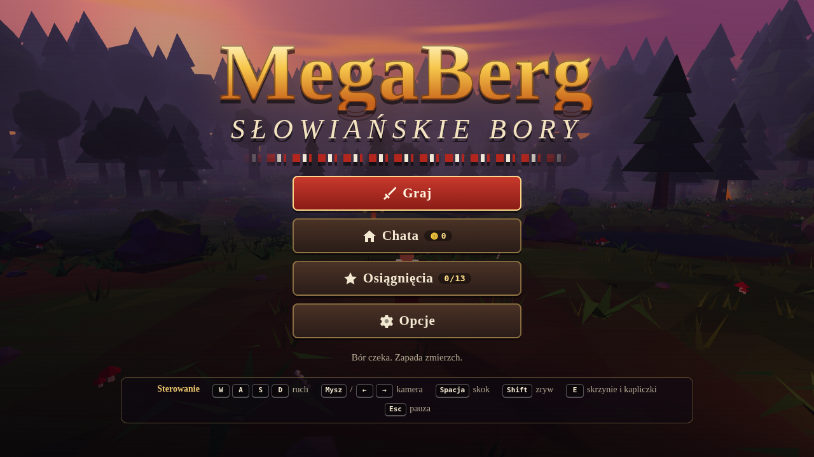 Menu główne | 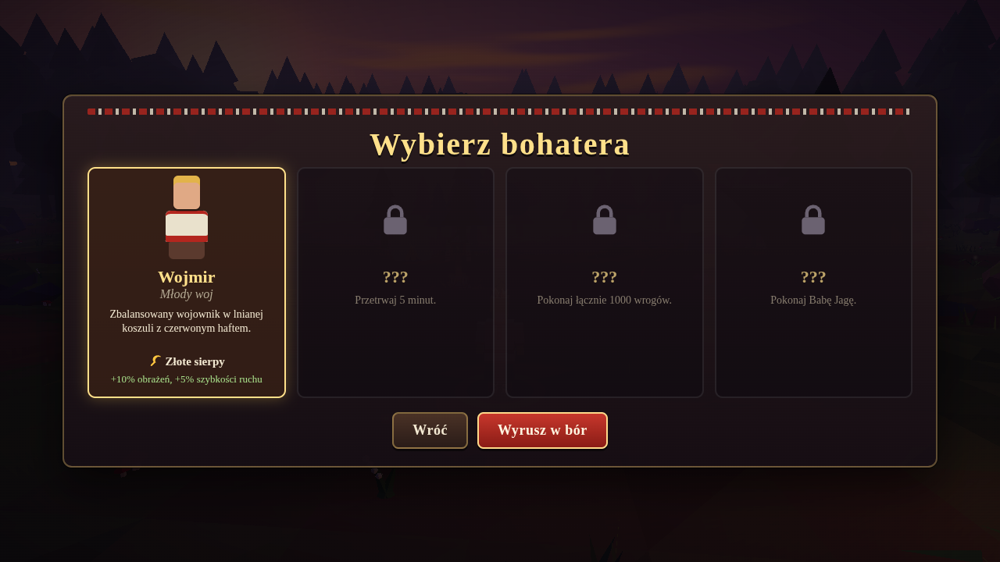 Wybór postaci |
| 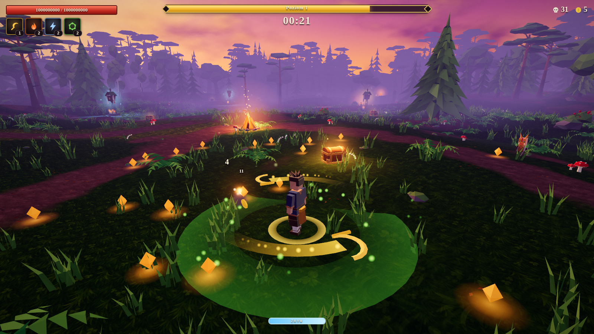 Początek runu, kapliczka i ognisko | 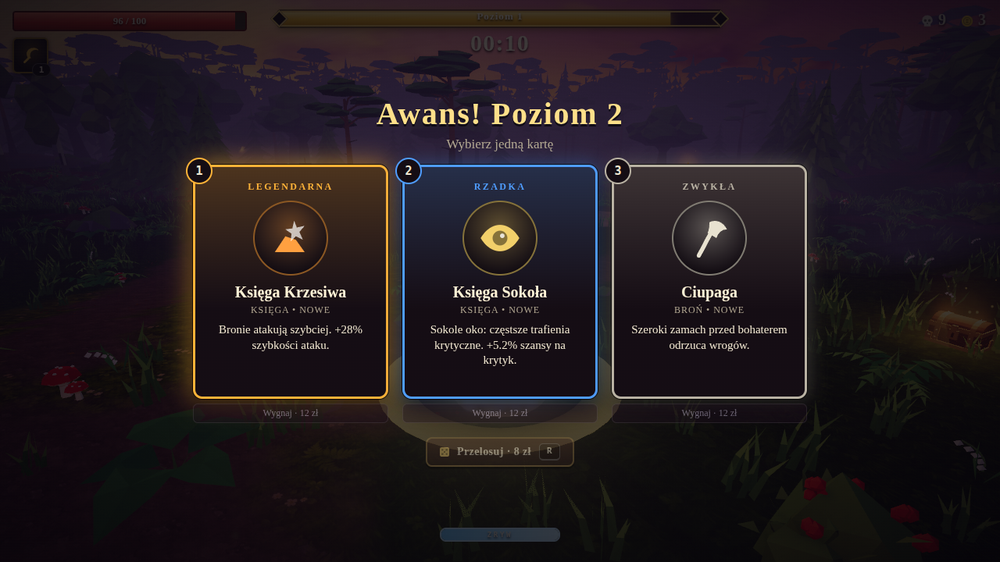 Karty awansu z rzadkością |
| 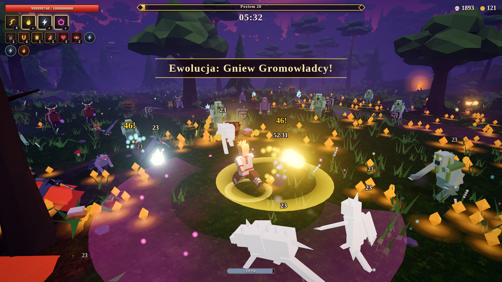 5:32, Południca | 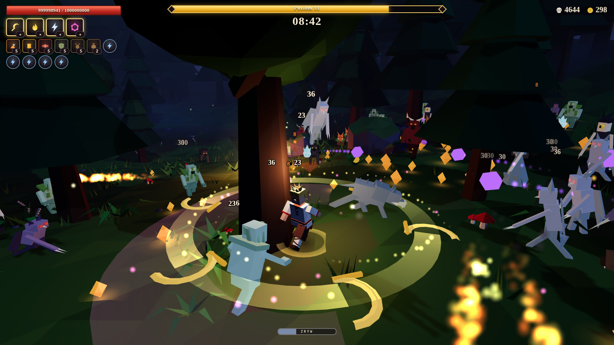 8:42, noc |
| 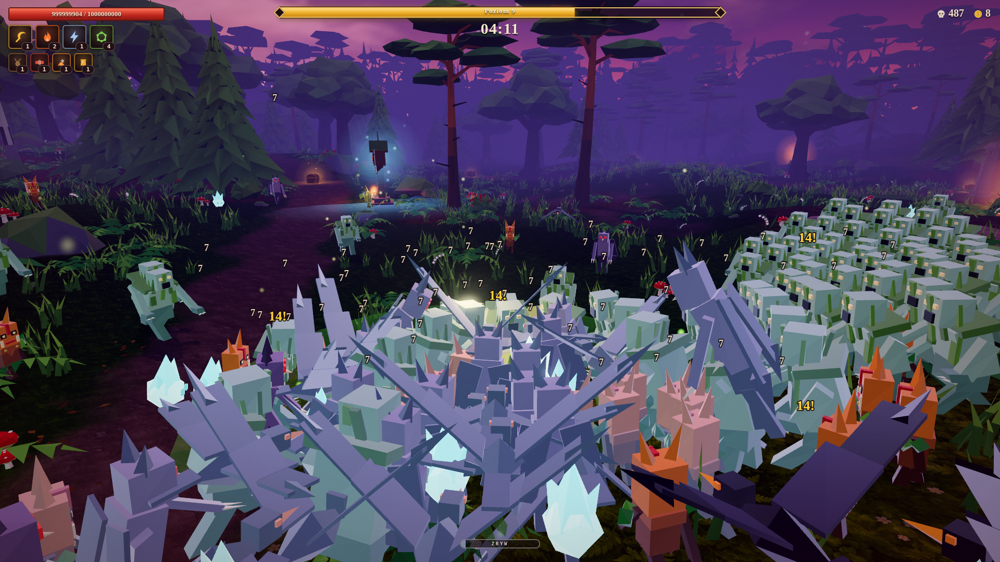 Test skali: 500 wrogów | 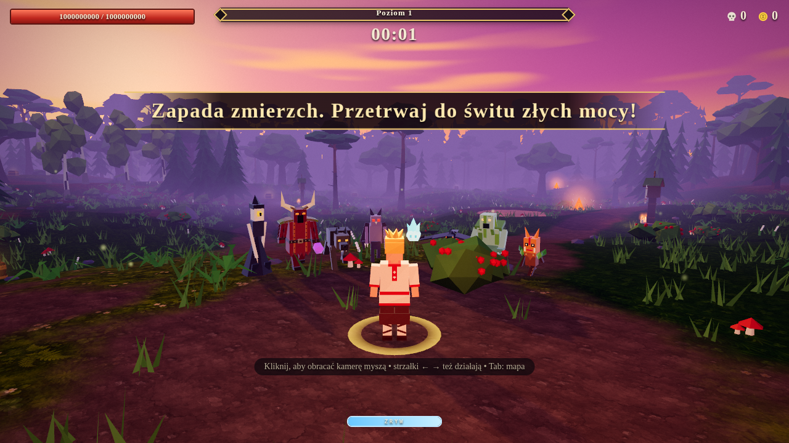 Ośmiu wrogów w szeregu |
| 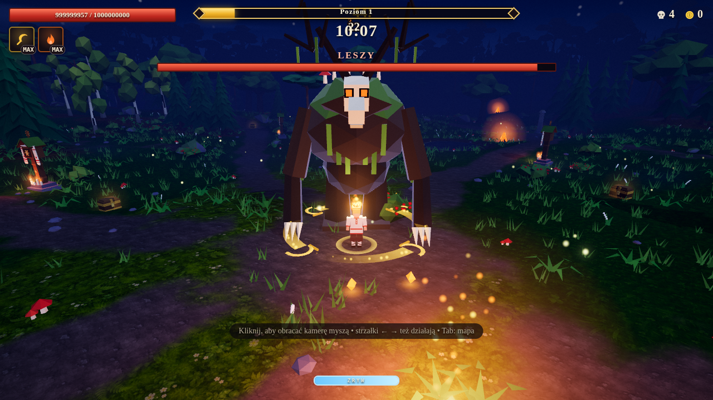 Leszy | 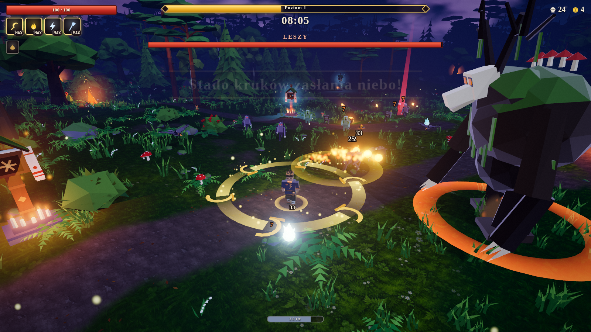 Finał z piorunami i kręgami ataków |
| 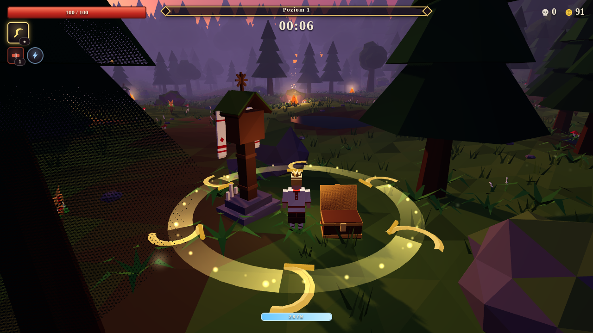 Ewolucja: Żniwa Mokoszy | 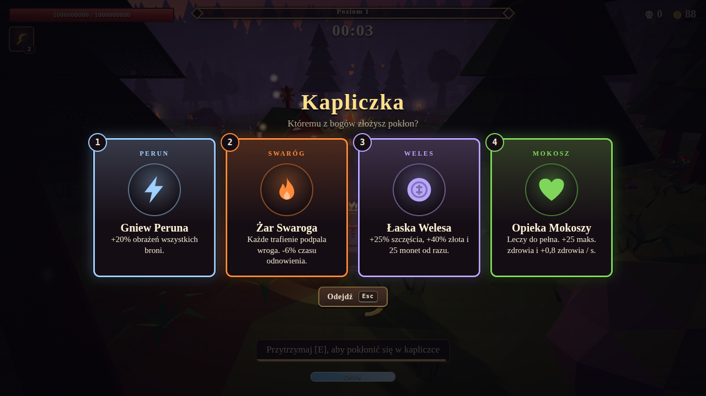 Błogosławieństwa bogów |
| 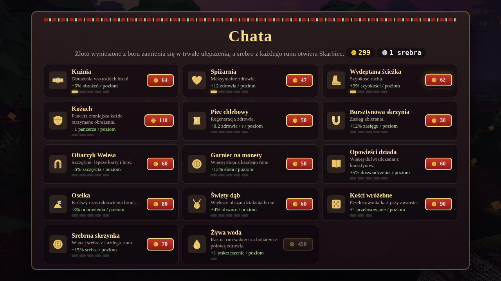 Chata | 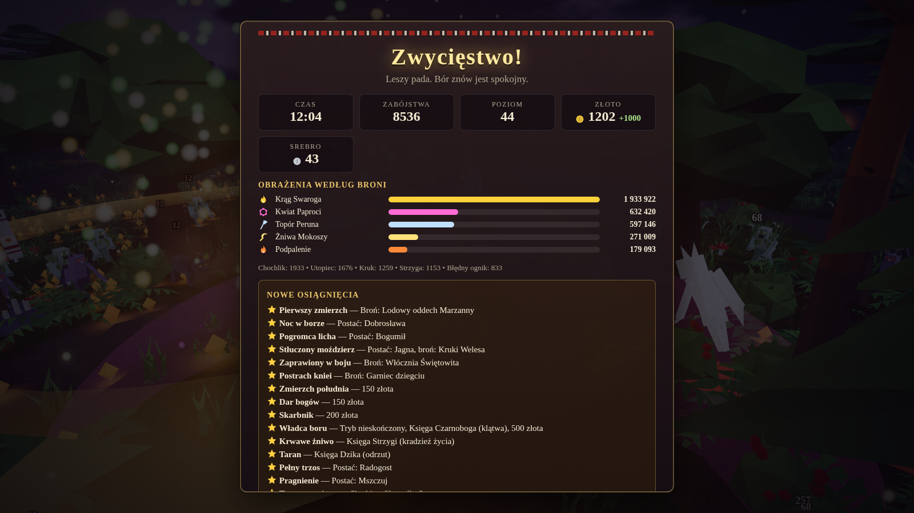 Ekran zwycięstwa |

## Znane problemy

- **Nie grał w to człowiek.** Czucie sterowania myszą, czytelność w tłumie i trudność są ocenione
  ze zrzutów, liczb i gry bota. To pierwsza rzecz do sprawdzenia rano.
- **Dźwięk nieodsłuchany** (patrz wyżej).
- **Silne buildy pod koniec czyszczą polanę szybciej, niż spawner ją zapełnia**: przy czterech ewolucjach
  żyje 60–150 wrogów zamiast docelowych 260–300. Gra nie robi się przez to łatwiejsza (zdrowie wrogów rośnie),
  ale „ściana hordy” jest rzadsza, niż mogłaby być.
- **Bot zostawia dużo bursztynów na ziemi**; pula ma 1400 sztuk i po zapełnieniu dokleja wartość do istniejących,
  więc doświadczenie nie przepada, ale na zrzutach z końcówki widać dywan bursztynów.
- **Liczby obrażeń** przy aurach potrafią zasypać ekran (limit 70 naraz); da się je wyłączyć w opcjach.
- **Modele są z pudełek i stożków.** Styl jest spójny i czytelny, ale to nie poziom koncept-artu:
  sierp wygląda jak wycinek torusa, a animacja wrogów to machanie kończyn w shaderze.
- **Leszy przechodzi przez drzewa** (celowo, żeby nie utknął), co z bliska wygląda umownie.
- **Utrata kontekstu WebGL** (np. po uśpieniu GPU) kończy sesję komunikatem z prośbą o odświeżenie strony;
  złoto z przerwanego runu jest wcześniej zapisywane, ale sam run nie jest wznawiany.
- **Brak sterowania dotykowego i padem.**

## Co bym zrobił dalej

1. Godzina gry ręcznej i strojenie: czułość myszy, długość nietykalności, gęstość pierwszych dwóch minut.
2. Odsłuch i miks dźwięku; drugi motyw muzyczny na walkę z bossem.
3. Druga mapa „Bagna Topielców” z własnym bossem (silnik jest gotowy: nowa mapa to nowe ziarno,
   paleta i tablica fal).
4. Gęstsze hordy w końcówce: szybszy spawner dla silnych buildów albo więcej elit zamiast zwykłych wrogów.
5. Lepsze modele (sierp, ciupaga w dłoni bohatera, animacja zamachu), portrety postaci w menu jako render 3D.
6. Obsługa pada i wznawianie runu po utracie kontekstu WebGL.
7. Więcej treści niskim kosztem: bronie i wrogowie to pojedyncze obiekty w `src/data/`.

## Review Codexem

`codex exec review --base <commit M1>` na całym kodzie gry. Codex zgłosił **4 uwagi (wszystkie P2),
wszystkie zasadne i poprawione**, każda z testem regresyjnym:

1. Faza Leszego była wspólna dla wszystkich bossów: dwa Leszy naraz (tryb nieskończony) wywoływały
   przejście fazy i przywołanie 12 wrogów w każdym kroku symulacji. Teraz faza jest zapisana per wróg.
2. 150 złota za Leszego wypadało jako monety w chwili, gdy zwycięstwo zatrzymywało symulację, więc
   przepadało przy „Menu” i „Jeszcze raz”. Teraz nagroda jest dopisywana od razu, a zwycięstwo zbiera też
   monety leżące na polanie.
3. Pasek zdrowia i kamera bossa gubiły żyjącego bossa, gdy ginął inny (np. Baba Jaga w czasie walki z Leszym).
   Teraz po każdej śmierci bossa wybierany jest następny żyjący, z pierwszeństwem dla Leszego.
4. Przejście do trybu nieskończonego zerowało licznik kapliczek i psuło osiągnięcie „Pobożny wędrowiec”.
   Teraz zerowane są tylko liczniki sumowane między runami (złoto, zabójstwa).

Drugi przebieg (`--uncommitted`, na poprawkach) dał jedną uwagę P2, też przyjętą: utrata kontekstu WebGL
w trakcie animacji śmierci lub zwycięstwa nie zapisywała runu.

Szczegóły: [DECISIONS.md](DECISIONS.md), sekcja „Review Codexem”.

## Gdzie co jest

- [README.md](../README.md): uruchomienie, sterowanie, mechaniki, struktura kodu, dodawanie broni i wrogów.
- [PLAN.md](PLAN.md): plan z początku nocy.
- [DECISIONS.md](DECISIONS.md): wszystkie decyzje podjęte bez pytania, z powodami.
- [PERF.md](PERF.md): pomiary wydajności i skąd się biorą.
